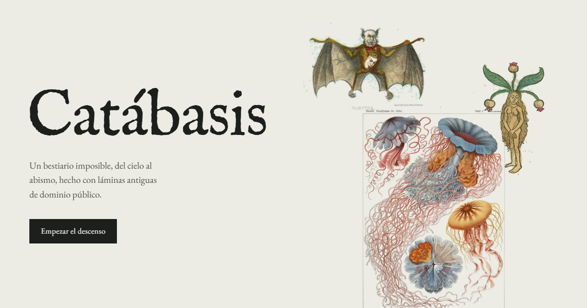

# Catábasis

**Un bestiario imposible, del cielo al abismo, hecho con láminas antiguas de dominio público.**

Un descenso por siete zonas (el aire, la fronda, la hojarasca, el subsuelo, el mar interior, el abismo y el osario) poblado por criaturas de grabados y litografías de los siglos XV a XX: aves con cara de vecino, flores dibujadas en Marte, una sirena que vivió cuatro días en una tina y el pulpo que abraza barcos. Cada lámina lleva una ficha inventada y, debajo, lo que de verdad es.

En vivo: **[pedrogomez.dev/proyecto/catabasis](https://pedrogomez.dev/proyecto/catabasis/)**



## Qué hay dentro

- **El descenso.** Una sola página en la que el papel se oscurece a medida que bajas y una sonda marca la profundidad. Cada zona tiene su propia composición: láminas que planean en el aire, pliegos de herbario en la fronda, un cajón de especímenes que se recorre en horizontal, estratos en el subsuelo y peces que derivan en el mar interior.
- **La linterna.** En el abismo no llega la luz: el puntero hace de linterna y las láminas de color brillan sin su papel.
- **El osario.** 19 esqueletos de la osteología comparada de d'Alton (1821-1838) para montar quimeras con la cabeza, el tronco y la cola de animales distintos: 6.859 combinaciones, cada una con su nombre en latín. La quimera se puede guardar como lámina en PNG.
- **El herbolario.** Las 152 láminas con filtro por zona, buscador, ficha completa y descarga.

## Cómo se prepararon las láminas

Las imágenes vienen del [Public Domain Image Archive](https://pdimagearchive.org/) y de la [Biodiversity Heritage Library](https://www.flickr.com/photos/biodivlibrary/). Todas son de dominio público y cada ficha enlaza a su origen.

1. Selección: 1.800 candidatas filtradas por tema, técnica y tamaño, puntuadas por cuánto papel limpio rodea al ejemplar y elegidas a mano en hojas de contacto.
2. Ampliación: las que no llegaban a 2.000 píxeles pasan por Real-ESRGAN x4plus, que respeta el trazo del grabado.
3. Papel: el tono del papel se normaliza a blanco y se recorta lo que sobra del escaneo. En la web se funden con `mix-blend-mode: multiply` sobre el papel de cada zona.
4. Color a alfa: las láminas de color tienen una versión sin papel para las zonas oscuras y el modo oscuro; las de línea se invierten y quedan como grabados luminosos.

Los scripts de Python están en [`pipeline/`](pipeline/LEEME.md).

## Desarrollo

```bash
npm test          # sintaxis, datos completos y archivos de cada lámina
npm run build     # genera dist/proyecto/catabasis desde app/ y app/data/laminas.json
npm run dev       # sirve dist con Wrangler en local
```

`app/data/laminas.json` es la fuente de verdad: zonas, fichas y créditos. Sin dependencias ni frameworks: HTML generado, CSS y módulos de JavaScript.

## Despliegue

Worker de Cloudflare con archivos estáticos (`wrangler.jsonc`), enganchado a la ruta `pedrogomez.dev/proyecto/catabasis`: `npm run deploy`.
GitHub Actions (`.github/workflows/ci.yml`) comprueba y construye en cada push y pull request.
